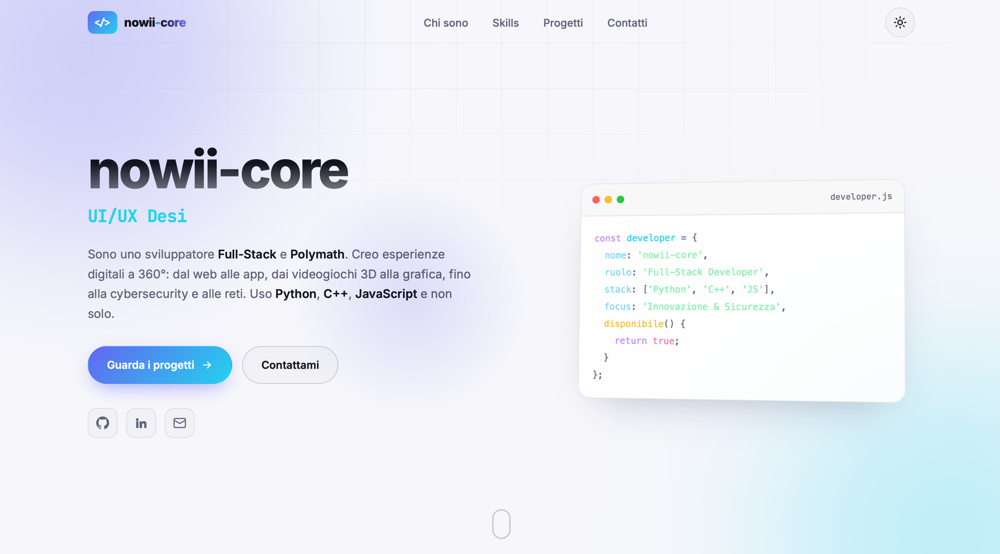

# Webspace

<p align="center">
  <b>A Modern, Responsive Web Application Template Built with Vanilla HTML5, CSS3, and JavaScript Featuring a Clean UI Design</b>
</p>

<p align="center">
  <a href="https://github.com/nowii-core/webspace/blob/main/LICENSE">
    
  </a>
  
  
  
  
</p>

<p align="center">
  <a href="#-overview">Overview</a> •
  <a href="#-key-features">Features</a> •
  <a href="#-tech-stack">Tech Stack</a> •
  <a href="#-project-architecture">Architecture</a> •
  <a href="#-quick-start">Quick Start</a> •
  <a href="#-contact">Contact</a>
</p>

---

</div>

## Overview

**Webspace** is a modern, structured web project developed entirely with pure HTML, CSS, and JavaScript. Designed with a strong focus on clean design and responsive principles, it serves as an excellent foundation or starter template for building high-performance web applications without the overhead of heavy external frameworks or dependencies.

---

## Preview



> **Live Demo:** [nowii-core.github.io/webspace/webspace/](https://nowii-core.github.io/webspace/webspace/)

---

## Key Features

- **Fully Responsive Design:** Optimized for a seamless viewing experience across all device sizes, including desktop, tablet, and mobile.
- **Modern Interface:** Carefully crafted styling featuring smooth transitions and fluid visual effects for a premium user experience.
- **Modular Structure:** Clean and well-organized architecture for both CSS components and JavaScript logic, ensuring easy maintainability.
- **High Performance:** Zero heavy external dependencies, guaranteeing lightning-fast load times and optimal performance.

---

## Tech Stack

### Frontend
- **HTML5:** Semantic and accessible page structure.
- **CSS3:** Advanced layouts using CSS Grid and Flexbox, custom properties, and smooth fluid animations.
- **JavaScript (ES6+):** Native logic handling, dynamic interactivity, and clean DOM manipulation.

---

## Project Architecture

```
webspace/
├── .github/                 # Issue/PR templates and CI/CD workflows
├── webspace/                # Core application source files
│   ├── assets/              # Icons, graphics, and static resources
│   ├── css/                 # Modular stylesheets (layout, components)
│   └── js/                  # Application logic and interactivity
├── Screenshot-1.png         # Application preview image
├── README.md                # Project documentation
└── index.html               # Main application entry point
```

---

## Quick Start

### Prerequisites
No build step or package manager is required. The project runs natively in the browser.

### Installation

1. **Clone the repository:**
   ```bash
   git clone https://github.com/nowii-core/webspace.git
   cd webspace
   ```

2. **Run the application:**
   Simply open the `index.html` file located in the `webspace/` directory in your preferred modern web browser. For the best development experience, you can use a local development server (e.g., VS Code Live Server extension).

---

## License

This project is distributed under the **MIT** license. See the [`LICENSE`](./LICENSE) file for more information.

---

## Contact & Support

- **Maintainer:** [@nowii-core](https://github.com/nowii-core)
- **Bug Reports & Feature Requests:** If you encounter an issue or would like to suggest an improvement, open an [Issue](https://github.com/nowii-core/webspace/issues) or submit a [Pull Request](https://github.com/nowii-core/webspace/pulls).

---

<div align="center">
  <sub>Developed by <b>nowii-core</b></sub>
</div>
